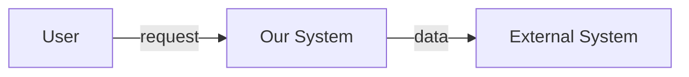

# /sdlc-init — Software Development Initial Phases

An end-to-end orchestrator for the **upstream / foundational** part of the SDLC.
It takes a rough idea and produces, in order:

1. A stakeholder map
2. Elicited & prioritized requirements
3. Functional requirements (use cases + user stories)
4. Non-functional requirements (quality attributes)
5. A validated Software Requirements Specification (SRS, IEEE 830 style)
6. A system definition (scope, boundaries, context, high-level system design)
7. A software architecture (C4 model, ADRs, tech stack, deployment)

Then it **generates the sub-skills** so the above can each be invoked on their own:
`/stakeholder-requirements`, `/requirements-analysis`, `/functional-requirements`,
`/non-functional-requirements`, `/system-building`, `/architecture-building`.

## Usage

```
/sdlc-init            # run the full pipeline, generate all sub-skills at the end
/sdlc-init --no-gen   # run the pipeline but do NOT write the sub-skills
/sdlc-init --phase N  # start/resume at a particular phase (1-7)
```

If invoked with no args and `docs/` already contains artifacts from a prior run,
detect them and offer to resume rather than overwrite.

---

## Ground Rules (apply to every phase)

- **Never invent facts.** Every requirement, stakeholder, and constraint must come
  from (a) the user, (b) web/code research you performed, or (c) an explicit assumption
  you flag as `ASSUMPTION:`. Label assumptions clearly so they can be challenged.
- **Write incrementally to disk.** Persist each artifact to `docs/<phase>.md` as you
  finish the phase, so a crash or interruption loses at most one phase.
- **Ask, don't assume.** When a decision materially changes the output, stop and ask
  the user using the `question` tool with concrete options. Default choices are fine
  for low-impact details.
- **One phase at a time.** Complete a phase, write its artifact, summarize, then ask
  the user to confirm before moving on (unless they used `--no-gen` with a batch flow).
- **Keep outputs scannable.** Bullets, tables, and checklists over prose paragraphs.
  Use the exact templates below.

---

## Phase 0 — Intake & Project Charter

Goal: capture the barest context needed to start.

Ask the user (in one block, using the `question` tool or plain prompt):

```
1. One-line product vision: what is this, in a sentence?
2. Problem being solved (2-3 sentences).
3. Target users / actors (who benefits, who pays, who operates it).
4. Platform & rough tech hints (web / mobile / desktop / API / embedded; any must-use stack).
5. Constraints already known (budget, deadline, compliance, must-nots).
6. Anything you already have (repo, docs, existing system to replace).
```

From the answers, write `docs/00-charter.md`:

```markdown
# Project Charter
_Generated: <date>_

## Vision
<one line>

## Problem
<2-3 sentences>

## Target Actors
- <actor>: <role>

## Platform / Tech Hints
- <...>

## Known Constraints
- <...>

## Existing Assets
- <repo / doc / system to replace>

## Phase Status
| Phase | Status |
|-------|--------|
| 1 Stakeholders | ☐ |
| 2 Elicitation | ☐ |
| 3 Functional | ☐ |
| 4 Non-Functional | ☐ |
| 5 SRS / Validation | ☐ |
| 6 System Building | ☐ |
| 7 Architecture | ☐ |
```

Ask the user to confirm the charter before proceeding.

---

## Phase 1 — Stakeholder Analysis

Produce a complete stakeholder map. Cover four dimensions for each stakeholder:
**power**, **interest**, **needs**, **how they influence the product**.

Use this classification:
- **Primary** (direct users / beneficiaries)
- **Secondary** (admins, support, ops, regulators)
- **Internal** (founders, dev team, finance)
- **External** (vendors, partners, auditors, the public)

Write `docs/01-stakeholders.md`:

```markdown
# Stakeholder Analysis
_Generated: <date>_

## Stakeholder Register
| ID | Name / Role | Type | Power | Interest | Key Needs | Influence on Product |
|----|-------------|------|-------|----------|-----------|----------------------|
| S1 | <...> | Primary | High | High | <...> | <...> |

## Engagement Plan
| Stakeholder | Comm. Channel | Frequency | Owner | Sign-off Authority |
|-------------|---------------|-----------|-------|--------------------|

## RACI (for the build)
| Activity | <S1> | <S2> | ... | Dev Team |
|----------|------|------|-----|----------|
| Requirements | A | R | ... | R |
| Architecture  | I | A | ... | R |

R=Responsible, A=Accountable, C=Consulted, I=Informed

## Open Questions for Stakeholders
- [ ] <question> — ask <stakeholder>
```

Capture, from stakeholders, the high-level goals they care about (these seed Phase 2).

Confirm with the user, then proceed.

---

## Phase 2 — Requirements Elicitation & Prioritization

Apply a **mix of elicitation techniques** (don't rely on one):
- **Interviews** (stakeholders from Phase 1)
- **Workshops / JAD** (consolidated session)
- **Questionnaires** (broad, low-cost)
- **Observation / contextual inquiry** (existing workflow)
- **Document analysis** (existing specs, regulator docs, legacy code)
- **Brainstorming / storyboarding** (early UI flows)
- **Prototyping** (throwaway UI / API mock) when ambiguity is high

For each discovered requirement record:
`ID | Source | Statement | Type(F/N) | MoSCoW | Notes`

Prioritize with **MoSCoW** (Must / Should / Could / Won't-this-release) and, for
larger sets, **100-point weighted voting** across stakeholders (weight by Power×Interest).

Write `docs/02-elicitation.md`:

```markdown
# Requirements Elicitation
_Generated: <date>_

## Techniques Used
- <technique>: <what was learned>

## Raw Requirement Backlog
| ReqID | Source | Statement | Type | MoSCoW | Confidence |
|-------|--------|-----------|------|--------|------------|

## Prioritization
### MoSCoW Summary
- Must: <ids>
- Should: <ids>
- Could: <ids>
- Won't (this release): <ids>

### Weighted Vote (top tensions)
- <req A> vs <req B>: chose <A> because <reason>

## Traceability Seed
Each ReqID here becomes a row later in the SRS traceability matrix.
```

Confirm with the user, then proceed.

---

## Phase 3 — Functional Requirements

Transform prioritized "Must/Should" requirements into precise, testable functional
requirements. Use **two complementary notations**:

1. **Use Cases** (for flows / interactions):
   `UC-<n>: <name>` with Actor, Preconditions, Main Success Scenario (numbered
   steps), Extensions (alternate/error flows `a/b/c`), Postconditions.
2. **User Stories** (for incremental delivery):
   `As a <role> I want <capability> so that <benefit>` + Acceptance Criteria.

Also produce a **FURPS+** functional checklist to ensure coverage:
Functionality, Usability (partial), Reliability (partial), Performance (partial),
Supportability, + (design, impl, interface, physical constraints).

Write `docs/03-functional.md`:

```markdown
# Functional Requirements
_Generated: <date>_

## Use Cases
### UC-1: <Name>
- Actor: <...>
- Preconditions: <...>
- Main Success Scenario:
  1. <...>
  2. <...>
- Extensions:
  - 2a. <error> → <handled by>
- Postconditions: <...>

## User Stories
| ID | Story | Acceptance Criteria | Maps to UC | MoSCoW |
|----|-------|---------------------|------------|--------|

## Functional Coverage (FURPS+ functional slice)
- [ ] <functionality area> covered by <UC/Story>

## Open Functional Questions
- [ ] <...>
```

Quality bar: a functional requirement is **done** only when it is unambiguous,
testable, and traceable to a stakeholder need.

Confirm with the user, then proceed.

---

## Phase 4 — Non-Functional Requirements

Capture quality attributes using **ISO/IEC 25010** categories, and quantify each
with a **measurable target** (no "fast" / "secure" without a number or test):

- **Performance** (throughput, latency percentiles, concurrency)
- **Reliability** (availability %, MTBF, MTTR, RPO/RTO)
- **Security** (authN/Z model, encryption, audit, OWASP coverage, compliance: GDPR/PCI/HIPAA)
- **Usability** (task success rate, learnability, accessibility WCAG level)
- **Maintainability** (modularity, test coverage %, doc standards)
- **Portability** (supported OS/browsers/runtimes)
- **Compatibility / Interoperability** (protocols, APIs, data formats)
- **Scalability** (growth curve, horizontal/vertical)
- **Cost / Resource** (budget, infra cost ceiling)

For each NFR write: `NFR-<n>: <attribute> | Target metric | Measurement method | Priority`.

Write `docs/04-nonfunctional.md`:

```markdown
# Non-Functional Requirements
_Generated: <date>_

## NFR Catalog (ISO/IEC 25010)
| NFR-ID | Attribute | Target | How Measured | Priority | Source |
|--------|-----------|--------|--------------|----------|--------|

## Quality Trade-offs (ATAM-style)
- <attribute A> conflicts with <attribute B>: resolution <...>

## Compliance & Constraints
- <regulation/standard>: <what we must do>

## Acceptance Thresholds
- Performance: p95 < X ms at Y RPS
- Availability: <Z>% over rolling 30 days
```

Confirm with the user, then proceed.

---

## Phase 5 — Requirement Validation & SRS

Consolidate Phases 1–4 into a single **Software Requirements Specification** (IEEE
830 / ISO/IEC/IEEE 29148 style) and **validate** it.

Validation checks (run explicitly, mark each):
- [ ] **Correctness** — matches stakeholder intent
- [ ] **Completeness** — no TBDs left unexplained
- [ ] **Consistency** — no conflicting requirements
- [ ] **Unambiguity** — one interpretation only
- [ ] **Verifiability** — each req has a test/measurement
- [ ] **Traceability** — every req traces to a stakeholder need
- [ ] **Feasibility** — technically & economically possible
- [ ] **Prioritization** — MoSCoW assigned

Validation techniques to perform: **review walkthrough**, **prototype check**,
**test-case drafting** (write 1 test case per Must requirement), **model checking**
(use-case completeness).

Write `docs/05-srs.md`:

```markdown
# Software Requirements Specification
_Generated: <date>_

## 1. Introduction
### 1.1 Purpose / Scope
### 1.2 Definitions, Acronyms
### 1.3 References

## 2. Overall Description
### 2.1 Product Perspective (see System Context, Phase 6)
### 2.2 Product Functions (summary of UC list)
### 2.3 User Classes & Characteristics
### 2.4 Operating Environment
### 2.5 Design / Implementation Constraints
### 2.6 Assumptions & Dependencies

## 3. Functional Requirements
<import use cases + stories from 03-functional.md, re-numbered FR-1..FR-n>

## 4. Non-Functional Requirements
<import from 04-nonfunctional.md, re-numbered NFR-1..NFR-n>

## 5. Data Requirements
<entities, volumes, retention>

## 6. External Interface Requirements
<UI, API, HW, comms>

## 7. Traceability Matrix
| ReqID | Stakeholder Need | Source Phase | Test Case | Status |
|-------|------------------|--------------|-----------|--------|

## 8. Validation Report
| Check | Result | Notes |
```

Confirm with the user, then proceed.

---

## Phase 6 — System Building (Scope, Context, High-Level Design)

Define the **system as a whole**: what is in/out, how it interacts with the world,
and a first-cut internal structure — *before* detailed software architecture.

Deliverables:
1. **System Boundary & Scope** — in-scope vs out-of-scope list; build vs buy vs reuse.
2. **System Context Diagram** (C4 Level 0) — the system as one box, surrounded by
   users and neighbouring systems, with the data/control flows between them.
   Produce as both an ASCII/mermaid diagram and a short narrative.
3. **High-Level System Decomposition** — major subsystems / components and their
   responsibilities and key interactions (C4 Level 1 "System Container" lite).
4. **End-to-End Data Flow** — for the top 3 core use cases, show data in → process → out.
5. **Build/Buy/Reuse decisions** — for each major capability.

Write `docs/06-system.md`:

```markdown
# System Building — Definition & High-Level Design
_Generated: <date>_

## 6.1 Scope
### In Scope
- <...>
### Out of Scope
- <...>

## 6.2 Build / Buy / Reuse
| Capability | Decision | Rationale | Candidate |
|------------|----------|-----------|-----------|

## 6.3 System Context (C4 L0)

Narrative: <...>

## 6.4 High-Level Subsystems (C4 L1)
| Component | Responsibility | Key Dependencies |
|-----------|----------------|------------------|

## 6.5 Core Data Flows
### DF-1: <use case>
in → <step> → out

## 6.6 Open System Questions
- [ ] <...>
```

Confirm with the user, then proceed.

---

## Phase 7 — Architecture Building

Produce a real **software architecture** built on the system definition from Phase 6.

Deliverables:
1. **Architectural Drivers** — the NFRs + constraints that most shape the design
   (pull from 04-nonfunctional.md; e.g., "availability 99.95% → needs redundancy").
2. **C4 Model** diagrams:
   - **L1 System Context** (reuse 06.3)
   - **L2 Container** (apps, services, datastores, brokers and their tech)
   - **L3 Component** (for the 2–3 most important containers)
   - (L4 classes only if the user asks)
3. **Architectural Style & Patterns** — justified choice (layered / hexagonal /
   microservices / event-driven / serverless / modular monolith) with trade-offs.
4. **Technology Selection** — per layer, with **justification** and **alternatives
   considered** (don't say "it depends" without a default + reason).
5. **Cross-Cutting Concerns** — logging, config, security, observability, CI/CD,
   error handling, i18n.
6. **Deployment & Runtime** — topology, environments (dev/stage/prod), scaling, DR.
7. **Architecture Decision Records (ADRs)** — one per significant decision, in the
   standard format (Status / Context / Decision / Consequences).
8. **Risks & Mitigations** — technical risks introduced by the architecture.

Write `docs/07-architecture.md`:

```markdown
# Software Architecture
_Generated: <date>_

## 7.1 Architectural Drivers
| Driver | Source NFR/Constraint | Impact on Design |
|--------|-----------------------|------------------|

## 7.2 Style & Patterns
Chosen: <style>
Rationale: <...>
Trade-offs accepted: <...>

## 7.3 C4 — Container Diagram (L2)
```mermaid
...
```
## 7.4 C4 — Component Diagrams (L3)
### Container: <name>
```mermaid
...
```

## 7.5 Technology Selection
| Layer | Choice | Alternatives Considered | Reason |
|-------|--------|-------------------------|--------|

## 7.6 Cross-Cutting Concerns
- Security: <...>
- Observability: <...>
- Config: <...>

## 7.7 Deployment & Runtime
Topology: <...>
Environments: dev / stage / prod
Scaling: <...>
DR / RTO-RPO: <...>

## 7.8 ADRs
### ADR-0001: <title>
- Status: Accepted
- Context: <...>
- Decision: <...>
- Consequences: <...>

## 7.9 Architecture Risks
- <risk> → mitigation <...>
```

Confirm with the user. This is the last analysis phase.

---

## Phase 8 — Generate the Sub-Skills (the "bunch of skills")

> Only run this phase if the user did **not** pass `--no-gen`. If they passed
> `--no-gen`, skip to the Final Summary.

Now you **create a focused, independently-invocable skill for each phase** so the
user can re-run any single phase later without replaying the whole pipeline.

Create the following directories and `SKILL.md` files under the user's Claude
skills folder (`~/.claude/skills/`). Use the exact YAML front-matter and deep
instruction body shown in **Appendix A** for each. For every skill:

1. `mkdir -p ~/.claude/skills/<name>`
2. Write `~/.claude/skills/<name>/SKILL.md` with the content from Appendix A.
3. Print `✓ created skill: <name>`.

Skills to generate:
| Skill name | Source phase | Trigger |
|------------|--------------|---------|
| `stakeholder-requirements` | Phase 1 | /stakeholder-requirements |
| `requirements-analysis` | Phases 2 + 5 | /requirements-analysis |
| `functional-requirements` | Phase 3 | /functional-requirements |
| `non-functional-requirements` | Phase 4 | /non-functional-requirements |
| `system-building` | Phase 6 | /system-building |
| `architecture-building` | Phase 7 | /architecture-building |

Each generated skill must read existing `docs/*.md` artifacts if present (so it can
resume / extend rather than start blank), and must write back to the same path used
by this pipeline. This keeps the skills and the pipeline mutually consistent.

After generating all six, verify they're discoverable:
```bash
ls -1 ~/.claude/skills/ | grep -E 'stakeholder-requirements|requirements-analysis|functional-requirements|non-functional-requirements|system-building|architecture-building'
```

---

## Final Summary

Print a map of what was produced:

```
━━━━━━━━━━━━━━━━━━━━━━━━━━━━━━━━━━━━━━━━━━━━━━━━━━━
  SDLC Foundation complete — <project name>
━━━━━━━━━━━━━━━━━━━━━━━━━━━━━━━━━━━━━━━━━━━━━━━━━━━
  docs/00-charter.md
  docs/01-stakeholders.md
  docs/02-elicitation.md
  docs/03-functional.md
  docs/04-nonfunctional.md
  docs/05-srs.md
  docs/06-system.md
  docs/07-architecture.md

  Sub-skills generated:
   /stakeholder-requirements
   /requirements-analysis
   /functional-requirements
   /non-functional-requirements
   /system-building
   /architecture-building

  Next: run /plan-project to turn the SRS into a sprint board,
        or /start-task to begin implementation.
━━━━━━━━━━━━━━━━━━━━━━━━━━━━━━━━━━━━━━━━━━━━━━━━━━━━━
```

Tell the user explicitly: "Foundation artifacts are in docs/. The six sub-skills are
now available — re-run any phase with its slash command."

---

## Appendix A — Sub-Skill Definitions (used by Phase 8)

Each block below is the **full SKILL.md content** to write for that sub-skill.
Copy verbatim (substituting nothing).

### A.1 stakeholder-requirements

```markdown
---
name: stakeholder-requirements
description: >
  Identify, classify, and analyze all project stakeholders; build a stakeholder
  register, engagement plan, and RACI. Use when the user says "stakeholder
  analysis", "who are the users", "map the stakeholders", or as part of early
  project setup. Reads docs/00-charter.md and writes docs/01-stakeholders.md.
trigger: /stakeholder-requirements
---

# /stakeholder-requirements

You are a requirements engineer. Produce a complete stakeholder analysis.

## Inputs
- Read `docs/00-charter.md` if it exists (vision, actors, constraints).
- Otherwise ask the user for: product vision, who benefits, who pays, who operates,
  who regulates.

## Steps
1. Enumerate stakeholders across four types: Primary, Secondary, Internal, External.
2. For each, capture Power, Interest, Key Needs, Influence on Product.
3. Build an Engagement Plan (channel, frequency, owner, sign-off authority).
4. Build a RACI for the build activities.
5. List open questions that must go back to stakeholders.

## Output
Write `docs/01-stakeholders.md` using this structure:
- Stakeholder Register table (ID, Name/Role, Type, Power, Interest, Key Needs, Influence)
- Engagement Plan table
- RACI table (R/A/C/I)
- Open Questions list

## Rules
- Never invent a stakeholder; every entry must come from the user or charter.
- Flag `ASSUMPTION:` for any inferred stakeholder.
- Keep tables scannable. Confirm with the user before finalizing.
```

### A.2 requirements-analysis

```markdown
---
name: requirements-analysis
description: >
  Elicit, prioritize, and validate requirements using mixed techniques (interviews,
  workshops, observation, documents, prototypes) and MoSCoW / weighted voting, then
  validate against IEEE 830 checks and emit a traceability matrix. Use when the user
  says "requirements analysis", "gather requirements", "validate the SRS", or
  "prioritize requirements". Reads docs/01-stakeholders.md; writes
  docs/02-elicitation.md and docs/05-srs.md.
trigger: /requirements-analysis
---

# /requirements-analysis

You are a senior requirements engineer. Run elicitation + prioritization + validation.

## Phase A — Elicitation
- Apply at least 3 techniques from: interviews, JAD workshops, questionnaires,
  observation, document analysis, brainstorming, prototyping.
- Record each raw requirement: ReqID | Source | Statement | Type(F/N) | MoSCoW | Confidence.

## Phase B — Prioritization
- Assign MoSCoW (Must/Should/Could/Won't-this-release).
- For conflicting priorities, run a 100-point weighted vote weighted by stakeholder
  Power×Interest; record the decision and rationale.

## Phase C — Validation (IEEE 830 / ISO 29148)
Run and mark each: Correctness, Completeness, Consistency, Unambiguity,
Verifiability, Traceability, Feasibility, Prioritization.
- Draft one test case per Must requirement.
- Produce a Traceability Matrix (ReqID → Stakeholder Need → Source → Test → Status).

## Outputs
- `docs/02-elicitation.md`: techniques used, raw backlog, MoSCoW summary, weighted
  votes, traceability seed.
- `docs/05-srs.md`: the full SRS skeleton (Introduction, Overall Description,
  Functional, Non-Functional, Data, Interfaces, Traceability, Validation Report).
  Pull functional/non-functional content from their dedicated docs if present.

## Rules
- Label assumptions as `ASSUMPTION:`.
- No TBDs without an explicit owner + due date.
- Confirm before finalizing.
```

### A.3 functional-requirements

```markdown
---
name: functional-requirements
description: >
  Turn prioritized requirements into precise, testable functional requirements using
  Use Cases and User Stories plus a FURPS+ coverage check. Use when the user says
  "functional requirements", "write the use cases", "user stories", or "what should
  the system do". Reads docs/02-elicitation.md; writes docs/03-functional.md.
trigger: /functional-requirements
---

# /functional-requirements

You are a requirements engineer. Produce functional requirements.

## Steps
1. Pull Must/Should requirements from `docs/02-elicitation.md` (or ask the user).
2. Write **Use Cases**: UC-<n> with Actor, Preconditions, Main Success Scenario
   (numbered), Extensions (alternate/error flows), Postconditions.
3. Write **User Stories**: "As a <role> I want <capability> so that <benefit>" with
   Acceptance Criteria; map each to a UC and a MoSCoW value.
4. Run a **FURPS+** functional coverage check to find gaps.

## Output
Write `docs/03-functional.md`:
- Use Cases (full template per UC)
- User Stories table (ID, Story, Acceptance Criteria, Maps-to-UC, MoSCoW)
- FURPS+ functional coverage checklist
- Open functional questions

## Quality bar
A functional requirement is done only when unambiguous, testable, and traceable to a
stakeholder need. Confirm with the user before finalizing.
```

### A.4 non-functional-requirements

```markdown
---
name: non-functional-requirements
description: >
  Capture quality attributes using ISO/IEC 25010, quantify each with a measurable
  target and measurement method, record trade-offs and compliance. Use when the user
  says "non-functional requirements", "NFRs", "quality attributes", "performance/
  security/availability targets". Reads docs/01-stakeholders.md; writes
  docs/04-nonfunctional.md.
trigger: /non-functional-requirements
---

# /non-functional-requirements

You are a requirements engineer focused on quality attributes.

## Steps
1. For each ISO/IEC 25010 category — Performance, Reliability, Security, Usability,
   Maintainability, Portability, Compatibility, Scalability, Cost — ask the user for
   a target or infer a sensible default and flag it.
2. Quantify every NFR: NFR-<n> | Attribute | Target metric | Measurement method |
   Priority. No vague words ("fast", "secure") without a number or test.
3. Identify quality trade-offs (ATAM-style): where two attributes conflict, state the
   resolution.
4. List compliance/regulatory constraints (GDPR/PCI/HIPAA/WCAG etc.) and what they
   require.

## Output
Write `docs/04-nonfunctional.md`:
- NFR Catalog table (NFR-ID, Attribute, Target, How Measured, Priority, Source)
- Quality Trade-offs section
- Compliance & Constraints section
- Acceptance Thresholds (concrete numbers)

## Rules
- Every NFR must be measurable. If you infer a number, mark `ASSUMPTION:`.
- Confirm with the user before finalizing.
```

### A.5 system-building

```markdown
---
name: system-building
description: >
  Define the system as a whole before detailed architecture: scope (in/out), build/
  buy/reuse, C4 Level 0/1 context, high-level subsystems, and core data flows. Use
  when the user says "system building", "define the system", "system context",
  "scope the project", or "high-level design". Reads docs/05-srs.md; writes
  docs/06-system.md.
trigger: /system-building
---

# /system-building

You are a systems engineer. Define the system boundary and high-level structure.

## Steps
1. Scope: explicit In Scope / Out of Scope lists.
2. Build/Buy/Reuse table for each major capability.
3. System Context Diagram (C4 L0) — system as one box with users + neighbour systems
   and the flows between them. Produce mermaid + narrative.
4. High-Level Subsystems (C4 L1 lite) — components, responsibilities, dependencies.
5. Core Data Flows for the top 3 use cases (in → process → out).
6. List open system questions.

## Output
Write `docs/06-system.md` with sections 6.1 Scope, 6.2 Build/Buy/Reuse, 6.3 System
Context (mermaid + narrative), 6.4 High-Level Subsystems table, 6.5 Core Data Flows,
6.6 Open Questions.

## Rules
- This is system definition, NOT software architecture (that is /architecture-building).
- Confirm with the user before finalizing.
```

### A.6 architecture-building

```markdown
---
name: architecture-building
description: >
  Design the software architecture from the system definition and NFRs: architectural
  drivers, C4 L2/L3 diagrams, style & patterns with trade-offs, technology selection
  with justified alternatives, cross-cutting concerns, deployment/runtime, and ADRs.
  Use when the user says "architecture", "design the system", "tech stack", "C4
  diagrams", "ADRs", or "deployment topology". Reads docs/06-system.md and
  docs/04-nonfunctional.md; writes docs/07-architecture.md.
trigger: /architecture-building
---

# /architecture-building

You are a software architect. Produce a defensible architecture.

## Steps
1. Architectural Drivers: pull the NFRs/constraints from docs/04-nonfunctional.md
   that most shape the design and state their design impact.
2. Choose an architectural style (layered / hexagonal / microservices / event-driven
   / serverless / modular monolith) with rationale + accepted trade-offs.
3. C4 diagrams: L2 Container (apps, services, datastores, brokers + tech) and L3
   Component for the 2–3 most important containers. Reuse L0/L1 from system-building.
4. Technology Selection table: Layer | Choice | Alternatives Considered | Reason.
   Be opinionated; never end on "it depends" without a default.
5. Cross-Cutting Concerns: security, observability, logging, config, CI/CD, error
   handling, i18n.
6. Deployment & Runtime: topology, environments, scaling, DR/RTO-RPO.
7. ADRs: one per significant decision (Status / Context / Decision / Consequences).
8. Architecture Risks with mitigations.

## Output
Write `docs/07-architecture.md` with sections 7.1 Drivers, 7.2 Style, 7.3 L2 diagram,
7.4 L3 diagrams, 7.5 Tech Selection, 7.6 Cross-Cutting, 7.7 Deployment, 7.8 ADRs,
7.9 Risks.

## Rules
- Every tech choice lists alternatives considered and a reason.
- Every major decision gets an ADR.
- Confirm with the user before finalizing.
```
