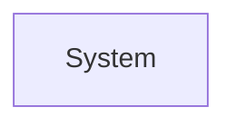

# Architecture Document — <Project Name>

**Version:** 0.1 &nbsp;|&nbsp; **Status:** Draft / Reviewed / Baselined

## 1. Architectural Drivers
The top NFRs and constraints that shape this architecture, restated:
1. NFR-nnn — ...
2. CON-nn — ...

## 2. System Context (C4-1)

## 3. Containers (C4-2)

| Container | Responsibility | Technology |
|---|---|---|

## 4. Components (C4-3) — for nontrivial containers only

## 5. Architectural Style & Rationale
Chosen style(s), one paragraph, full comparison in ADR-nnn.

## 6. Cross-Cutting Concerns
| Concern | Decision |
|---|---|
| Auth / AuthZ | |
| Error handling | |
| Configuration | |
| Logging / metrics / tracing | |
| Idempotency | |
| Data consistency | |
| Caching | |
| API versioning | |

## 7. Technology Stack
| Layer | Choice | Rationale (summary — full comparison in ADR) |
|---|---|---|

## 8. Data Architecture
How the logical data model maps to physical storage; partitioning/sharding if any.

## 9. Deployment View
Environments, CI/CD, rollback approach.

## 10. Architecture Decision Records
| ID | Title | Status | Date |
|---|---|---|---|
| ADR-001 | | Accepted / Rejected / Superseded | |

(Full ADRs in `adr-log.md` or one file per ADR.)

## 11. Risk Register
| ID | Risk | Likelihood | Impact | Mitigation | Owner |
|---|---|---|---|---|---|
| RSK-01 | | | | | |

## 12. Deferred Decisions
| Decision | Why deferred | Trigger to revisit |
|---|---|---|
