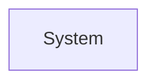

# Requirements Specification — <Project Name>

**Version:** 0.1 (draft) &nbsp;|&nbsp; **Tier:** Lite / Standard / Rigorous &nbsp;|&nbsp; **Status:** Draft / In Review / Baselined

---

## 1. Problem Statement
Who is affected · What they are trying to do · What blocks them today · Cost of the status quo · What "solved" looks like

## 2. Goals & Success Metrics
| Level | Statement | Metric | Baseline | Target |
|---|---|---|---|---|
| Business | | | | |
| User | | | | |
| System | | | | |

**Anti-goals:**

## 3. Scope
**In scope:** ·
**Out of scope (with reason):** ·
**Deferred (with horizon):** ·

## 4. Context Diagram

## 5. Constraints
| ID | Category | Statement | Hard/Soft | Source |
|---|---|---|---|---|
| CON-01 | | | | |

## 6. Assumptions
| ID | Statement | Impact if false | Validation | Owner | Status |
|---|---|---|---|---|---|
| ASM-01 | | | | | Open |

## 7. Glossary
| Term | Definition | Synonyms | Source |
|---|---|---|---|

---

## 8. Stakeholders
See `stakeholder-register.md`.

## 9. Functional Requirements

### FR-001 — <Title>
- **Statement:** The system shall...
- **Trace to:** STK-nn
- **Priority:** Must / Should / Could / Won't
- **Actor:**
- **Preconditions:**
- **Postconditions:**
- **Alternate flows:**
- **Error handling:**
- **Acceptance criteria:** AC-001.1 ...
- **Status:** Draft / Approved / Withdrawn

<!-- Duplicate per requirement -->

## 10. Business Rules
| ID | Type | Statement | Source | Volatility | Used by |
|---|---|---|---|---|---|
| BR-01 | | | | | |

## 11. Use Cases / User Stories
See dedicated use-case or story catalog if extensive; otherwise inline here.

## 12. Non-Functional Requirements

### NFR-001 — <Title>
- **Category (ISO 25010):**
- **Statement:**
- **Metric / Target / Minimum acceptable:**
- **Conditions:**
- **Measurement method:**
- **Rationale:**
- **Source:**
- **Priority:**
- **Trace:**

<!-- Duplicate per requirement -->

## 13. Open Questions
| ID | Question | Owner | Deadline | Default if unresolved |
|---|---|---|---|---|
| OQ-01 | | | | |

---

## 14. Traceability Matrix
| ID | Source (STK) | Design element | Verified by | Status |
|---|---|---|---|---|

## 15. Sign-off
| Artifact | Approver | Approved | Date |
|---|---|---|---|
