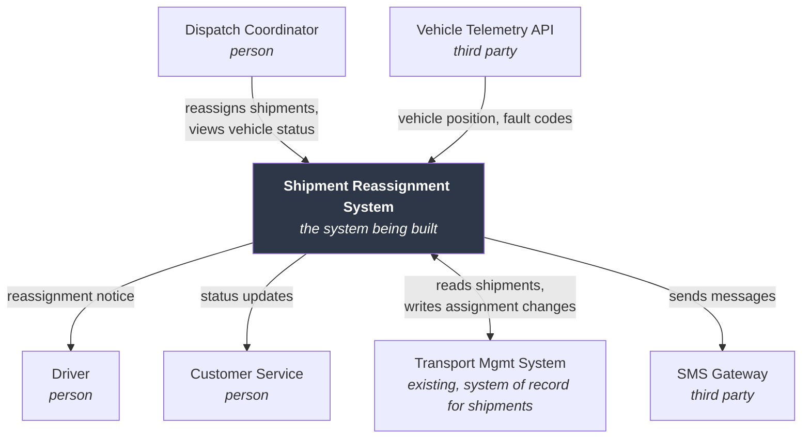

# Phase 1 — Problem & Context Discovery

Goal: establish what problem exists, who has it, where the system's boundary sits, and what is already fixed before anyone starts specifying behavior.

Skipping this phase is what produces systems that meet their requirements and still fail. The requirements were answers to the wrong question.

## Contents
- [1. Problem statement](#1-problem-statement)
- [2. Goals and success metrics](#2-goals-and-success-metrics)
- [3. Scope and boundary](#3-scope-and-boundary)
- [4. Context diagram](#4-context-diagram)
- [5. Constraints](#5-constraints)
- [6. Assumptions](#6-assumptions)
- [7. Glossary](#7-glossary)
- [8. Existing system analysis (brownfield)](#8-existing-system-analysis-brownfield)
- [Exit criteria](#exit-criteria)

---

## 1. Problem statement

Write it before writing any solution language. Use this five-part frame:

```
PROBLEM STATEMENT

Who is affected:      <specific role or segment, not "users">
What they are trying to do: <the job, in their words>
What blocks them today:     <the current obstacle or workaround>
Cost of the status quo:     <time, money, risk, missed opportunity — quantified if possible>
What "solved" looks like:   <observable end state, no technology named>
```

**Example — weak:** "Users need a better dashboard for logistics."

**Example — strong:** "Dispatch coordinators at regional warehouses (14 people, 3 shifts) must reassign shipments when a vehicle breaks down. Today they phone the depot, check a shared spreadsheet updated hourly, and manually notify drivers — averaging 22 minutes per reassignment, during which the shipment's location is unknown to customer service. Roughly 40 reassignments/week. Solved means a coordinator can reassign a shipment and have all affected parties notified within 3 minutes, with the shipment's status never going stale."

The second version already implies requirements, actors, an integration, and a performance target — and it names no technology.

### Pushing past the stated problem

Ask "why" until the answer stops changing. The five-whys chain frequently relocates the real problem:

> "We need a mobile app." → Why? → "Field staff can't file reports from site." → Why does that matter? → "Reports get filed next morning from memory." → Why is that a problem? → "Photos are missing and timestamps are wrong, so 30% of insurance claims get rejected."

The problem is claim rejection from incomplete evidence capture. A mobile app is one candidate solution; so is an SMS gateway, so is a camera with a sync dock. Recording the chain keeps the option space open.

## 2. Goals and success metrics

Separate three levels — they get conflated constantly and the conflation causes scope fights later.

| Level | Question | Example |
|---|---|---|
| **Business goal** | Why does the organization fund this? | Reduce claim rejection rate from 30% to under 8% within two quarters |
| **User goal** | What does a person accomplish? | File a complete site report before leaving the site |
| **System goal** | What must the software do to enable that? | Capture geotagged photos offline and sync on reconnect |

Each business goal needs a metric, a baseline, a target, and a measurement method. "Improve efficiency" with no baseline cannot be claimed or refuted, which means the project can never be declared successful or failed — a surprisingly common and corrosive situation.

Also record **anti-goals**: things the system explicitly will not optimize for. "Not a replacement for the finance system." "Not intended for public/unauthenticated use." Anti-goals prevent more scope creep than scope statements do.

## 3. Scope and boundary

Produce three lists. The third is the one that matters.

- **In scope** — capabilities this system provides.
- **Out of scope** — capabilities deliberately excluded, *with the reason*. "Excluded" without a reason gets relitigated monthly.
- **Deferred** — desired but not in this release, with a rough horizon. This is where politically difficult exclusions go to survive.

Then state the boundary explicitly:

- What data does the system own (system of record) versus merely cache or display?
- Which processes does it automate versus support versus leave untouched?
- What does it delegate to external systems?

Ownership confusion is the most expensive boundary error. If two systems both believe they own customer address, you have a data reconciliation project you didn't budget for.

## 4. Context diagram

The context diagram is the highest-value artifact in this phase relative to effort. One box for the system, surrounded by every external actor and system, with labeled data flows. It makes boundary disagreements visible in seconds.



For every arrow, note direction, payload, trigger (user action / schedule / event), and rough volume. Those four facts drive integration requirements, NFRs, and failure-mode analysis later.

**Checklist for completeness** — actors that get forgotten: administrators, support staff, auditors, regulators, batch/scheduled processes, other teams' systems that read your database directly, the data team's analytics pipeline, and whoever handles incidents at 3am.

## 5. Constraints

Constraints are non-negotiable inputs. They differ from requirements in that they aren't chosen — they're imposed. Log each with `CON-nn`, category, source, and effect.

| Category | Typical examples |
|---|---|
| **Regulatory / legal** | GDPR, DPDP Act, HIPAA, PCI-DSS, data residency, accessibility law, audit retention |
| **Organizational** | Mandated cloud vendor, approved language list, existing auth provider, procurement rules |
| **Technical** | Must integrate with legacy SOAP API, must run on-premises, browser support floor, offline operation |
| **Resource** | Team size and skills, budget ceiling, fixed launch date, licensing costs |
| **Environmental** | Intermittent connectivity, shared devices, gloves/outdoor use, low-end hardware |

Distinguish **hard** constraints (violating them fails the project) from **soft** ones (preferences with a cost to override). Users state both in identical language; ask "what happens if we don't?" to separate them. A soft constraint misfiled as hard eliminates good options for no reason.

## 6. Assumptions

Every assumption is a risk with a friendly face. Record with `ASM-nn`:

| Field | Purpose |
|---|---|
| Statement | What is being taken as true |
| Rationale | Why it's plausible |
| Impact if false | What breaks — this determines priority |
| Validation method | How and when it gets confirmed |
| Owner | Who confirms |
| Status | Open / Confirmed / Invalidated |

Assumptions with high impact-if-false and no validation plan are the project's actual risk profile. Promote those to the risk register (`RSK-nn`) in Phase 7.

## 7. Glossary

Start it now; append throughout. Domain terms carry precise meaning to insiders and vague meaning to everyone else, and the ambiguity survives all the way into the schema.

For each term: definition, synonyms encountered, terms it's often confused with, and the authoritative source.

The tell that you need this: two stakeholders use the same word and you notice they mean different things. In one logistics project "delivery" meant the physical drop-off to drivers, the invoice event to finance, and the customer-visible status to support. Three meanings, one word, three months of confusion.

This glossary becomes a generated skill in Phase 9 — it is the highest-leverage artifact for future sessions.

## 8. Existing system analysis (brownfield)

If replacing or extending something, add:

- **Capability inventory** — what it currently does, and which parts are actually used. Usage data beats opinion; features people swear are critical often show near-zero usage.
- **Pain inventory** — what fails, with frequency and cost. Sort by cost, not by how loudly it's complained about.
- **Data reality** — actual volumes, growth rate, quality problems, and the encoding sins hiding in production (status fields holding six meanings, dates as strings, the `notes` column used as a queue).
- **Integration inventory** — everything reading from or writing to it, *including the undocumented ones*. Grep for direct database connections; there are always more consumers than the documentation admits.
- **Hard-won behaviors** — weird rules that exist because of a real incident. These look like bugs, get "cleaned up" in the rewrite, and then the incident recurs. Ask specifically: "which behaviors look wrong but are load-bearing?"
- **Migration constraints** — cutover window, dual-run period, rollback plan, historical data fidelity.

## Exit criteria

Move to Phase 2 when:

- [ ] Problem statement written and confirmed by at least one real stakeholder
- [ ] Business/user/system goals separated, with metrics and baselines
- [ ] In/out/deferred scope lists written, exclusions carry reasons
- [ ] Context diagram covers every external actor and system, with labeled flows
- [ ] Constraints logged, hard vs soft separated
- [ ] Assumptions logged with impact and validation plan
- [ ] Glossary has entries for every term used ambiguously so far
- [ ] (Brownfield) Existing system inventoried, including undocumented integrations
