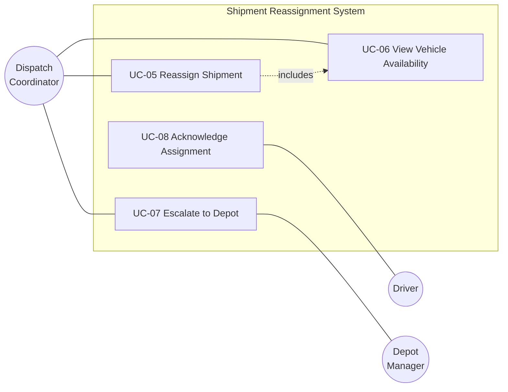
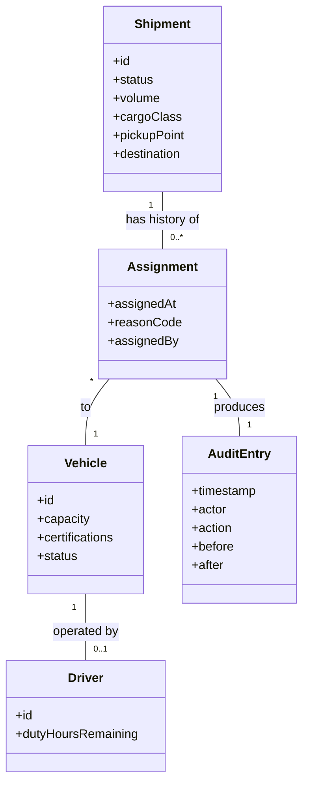

# Phase 4 — Functional Requirements

Goal: specify what the system does — every behavior, precisely enough to build and test, traceable to a stakeholder need.

A functional requirement describes a stimulus, a system response, and the conditions under which the response occurs. If any of those three is missing, the requirement is incomplete no matter how confident it sounds.

## Contents
- [1. Anatomy of a functional requirement](#1-anatomy-of-a-functional-requirement)
- [2. Writing rules](#2-writing-rules)
- [3. Organizing the catalog](#3-organizing-the-catalog)
- [4. User stories](#4-user-stories)
- [5. Use cases](#5-use-cases)
- [6. Business rules](#6-business-rules)
- [7. Domain model](#7-domain-model)
- [8. Data flow diagrams](#8-data-flow-diagrams)
- [9. Acceptance criteria](#9-acceptance-criteria)
- [10. Coverage sweeps](#10-coverage-sweeps)
- [Exit criteria](#exit-criteria)

---

## 1. Anatomy of a functional requirement

```
FR-014  Reassign shipment to alternate vehicle

Statement:
  When a dispatch coordinator selects an in-transit shipment and chooses
  an alternate vehicle from the eligible list, the system shall transfer
  the assignment, record the reason code, and emit a ShipmentReassigned
  event within 2 seconds.

Trace to:      STK-07, STK-12
Priority:      Must
Source:        Interview R. Kumar 2026-08-04; ticket cluster TKT-4471..4502
Actor:         Dispatch Coordinator
Trigger:       Coordinator confirms reassignment
Preconditions: Shipment status = IN_TRANSIT; coordinator has REASSIGN
               permission for the shipment's region
Postconditions:Shipment.vehicle updated; audit entry written;
               ShipmentReassigned event published
Business rules:BR-04 (eligibility), BR-09 (reason code mandatory above ₹50k)
Alternate flows:
  A1 Vehicle becomes ineligible between listing and confirmation
     → reject, refresh list, explain why
  A2 Shipment delivered concurrently
     → reject with "already delivered", no state change
Error handling:
  E1 TMS unavailable → queue reassignment, mark PENDING_SYNC, notify
     coordinator that driver notification is delayed
Acceptance criteria: AC-014.1 .. AC-014.5 (see §9)
Status:        Approved
Verification:  Integration test + UAT scenario UAT-08
```

Not every requirement needs every field — Lite tier can collapse to statement, trace, priority, and acceptance criteria. But **statement, trace, and acceptance criteria are never optional**: without a trace you can't justify it, and without acceptance criteria you can't verify it.

## 2. Writing rules

**One requirement, one behavior.** "The system shall validate the address and send a confirmation email" is two requirements. Compound requirements can be partially implemented and partially tested, which means status is never accurate.

**Active voice, named actor.** "The system shall notify the driver" — not "the driver shall be notified," which hides who does it and is a frequent source of "I thought your component did that."

**Shall / should / may used strictly.** *Shall* = mandatory. *Should* = recommended, non-binding. *May* = optional. Never use "will" (ambiguous between requirement and statement of fact) or "must" mixed with "shall" (implies a distinction you don't have).

**Ban unquantified adjectives and adverbs.** Fast, robust, user-friendly, seamless, efficient, intuitive, appropriate, sufficient, timely, minimal, optimal, easily, quickly. Each hides an unstated number. Replace with the number or move it to an NFR with a measurement method.

**Ban open-ended lists.** "etc.", "and so on", "including but not limited to", "such as". They make the requirement unbounded and therefore untestable. Enumerate, or state the rule that generates the set.

**Avoid "and/or".** Specify which.

**Specify the negative and boundary cases.** What happens when the input is empty, over the limit, duplicated, arriving out of order, or arriving twice? Requirements that only describe the happy path guarantee that failure behavior gets invented by whoever implements it, differently in each component.

**Say what, not how.** "The system shall persist the draft" is a requirement; "the system shall write the draft to Redis with a 24h TTL" is a design decision that belongs in Phase 7 or an ADR. Premature design in requirements removes options and hides the actual constraint. If the mechanism genuinely *is* mandated (e.g., a compliance-required encryption standard), record it as a `CON-nn` constraint so the reason is visible.

**Quick test before accepting any requirement:** *Can I write a test that fails if this isn't implemented?* If not, rewrite it.

## 3. Organizing the catalog

Choose one primary organizing scheme and hold to it — mixed schemes make requirements impossible to find and duplicates inevitable.

| Scheme | Works when | Watch out for |
|---|---|---|
| **By feature / capability** | Most projects | Cross-cutting behavior gets duplicated |
| **By user role** | Strongly role-differentiated systems | Shared functionality scattered |
| **By business process** | Workflow-heavy domains | Doesn't fit non-linear usage |
| **By subsystem** | Brownfield with fixed structure | Pre-commits to an architecture before Phase 7 |
| **By use case** | Interaction-heavy | Batch and background behavior fits poorly |

Feature-based with an explicit cross-cutting section (auth, audit, notification, search, export, admin) is the safest default.

## 4. User stories

Stories complement requirements; they don't replace them. A story is a placeholder for a conversation and a unit of planning. A requirement is a specification. Agile teams often need only stories with strong acceptance criteria; regulated or contract work needs both.

```
US-021  As a dispatch coordinator,
        I want to reassign a shipment to a nearby available vehicle
        so that I can recover from a breakdown without calling the depot.

Acceptance criteria (Gherkin):
  Given a shipment in transit and a breakdown reported
    And at least one eligible vehicle within 15 km
   When I select the shipment and choose an alternate vehicle
   Then the assignment transfers
    And the new driver receives a notification within 60 seconds
    And the previous driver's task list no longer shows the shipment
    And an audit entry records who reassigned, when, and why

  Given no eligible vehicle within 15 km
   When I open the reassignment view
   Then I see an explanation of why each nearby vehicle is ineligible
    And I can escalate to the depot manager from that screen

Size: M     Trace: STK-07, FR-014, FR-015
```

**INVEST check:** Independent (minimal ordering constraints), Negotiable (states the need, not the design), Valuable (to a user or buyer — "refactor the DAO" is a task, not a story), Estimable, Small (fits a sprint), Testable.

**Splitting patterns when a story is too large:** by workflow step, by business rule variation, by data type, by interface (API before UI), by CRUD operation, happy path first then error paths, or hard-coded first then configurable. Splitting by architectural layer ("backend story" + "frontend story") is an anti-pattern — neither half delivers observable value.

## 5. Use cases

Use cases beat stories when interaction is complex, alternate flows matter, or the audience needs to see the whole sequence. Also frequently mandated in academic and enterprise contexts.

```
UC-05  Reassign Shipment
Primary actor:   Dispatch Coordinator
Scope:           Shipment Reassignment System
Level:           User goal
Stakeholders &   Coordinator — wants it done fast, without leaving the board
  interests:     Driver — wants accurate, timely task list
                 Customer Service — wants status never stale
                 Compliance — wants every change attributable
Preconditions:   Coordinator authenticated; shipment IN_TRANSIT
Success guarantee: Shipment assigned to new vehicle; all parties notified;
                 audit entry written
Trigger:         Coordinator initiates reassignment

Main success scenario
  1. Coordinator selects an in-transit shipment.
  2. System displays eligible alternate vehicles with distance, capacity,
     and current load.
  3. Coordinator selects a vehicle and enters a reason code.
  4. System validates eligibility and permission.
  5. System transfers the assignment and writes the audit entry.
  6. System notifies the new driver, the previous driver, and CS.
  7. System confirms completion to the coordinator.

Extensions
  2a. No eligible vehicles
      2a1. System lists nearby vehicles with the reason each is ineligible.
      2a2. Coordinator escalates to depot manager. Use case ends.
  4a. Vehicle became ineligible since step 2
      4a1. System rejects, explains, and refreshes the list. Return to 2.
  4b. Coordinator lacks permission for the region
      4b1. System rejects and offers to request approval. Use case ends.
  5a. TMS unavailable
      5a1. System queues the change as PENDING_SYNC.
      5a2. System warns that driver notification is delayed.
      5a3. System retries per NFR-011; on repeated failure alerts ops.
  6a. Driver notification fails (device offline)
      6a1. System retries for 10 minutes, then alerts the coordinator.

Special requirements: Completes within 3 min end-to-end (STK-07);
                      usable one-handed on mobile (persona: Coordinator)
Frequency:            ~40/week, peaking Monday mornings
Open questions:       OQ-07 — can a shipment be reassigned twice in transit?
```

**Common mistakes:** writing UI steps ("clicks the blue button") instead of intent — it locks the interface before design; putting all the interesting behavior in the main scenario and leaving extensions empty — extensions are where the real requirements hide; and one giant use case covering an entire subsystem, which is really a process model.

A use case diagram is a **summary**, not a specification. Draw it for orientation and audience communication, but the text carries the content.



## 6. Business rules

Business rules constrain behavior and usually apply across many requirements. Cataloging them separately prevents the same rule from being restated inconsistently in six places — and inconsistent restatement is one of the most reliable sources of production defects.

| Type | Example |
|---|---|
| **Fact / definition** | A shipment is "in transit" from vehicle departure until delivery confirmation |
| **Constraint** | A vehicle shall not be assigned beyond its rated capacity |
| **Derivation** | ETA = current position → destination via routing service, plus 12 min handling |
| **Action enabler** | If a shipment is delayed more than 30 min, notify customer service |
| **Inference** | A driver with no assignments in 15 min is considered available |

```
BR-04  Vehicle eligibility for reassignment
  A vehicle is eligible if: status = ACTIVE, remaining capacity ≥ shipment
  volume, current route passes within 15 km of pickup point, driver has
  ≥ 2h remaining duty hours, and vehicle certification covers the cargo class.
Source:     Operations manual §4.2; confirmed with depot manager 2026-08-05
Volatility: Medium — the 15 km threshold is tuned seasonally
Used by:    FR-014, FR-016, UC-05
```

Record **volatility**. High-volatility rules should be configuration or a rules table, not code — that's an architectural requirement and it belongs in Phase 7's input. Rules whose thresholds are tuned by business users must not require a deployment to change.

## 7. Domain model

A conceptual model of the domain's entities and relationships — not a database schema. It settles vocabulary and cardinality before either the API or the schema hardens.



For each entity: definition (from the glossary), identity (what makes two instances the same), lifecycle (states — model these in Phase 6), ownership (which system is the source of truth), and key attributes with types and constraints.

Cardinality is where hidden requirements live. "A driver operates one vehicle" — always? What about shift handover, relief drivers, double-crewed long-haul? Interrogate every `1` in the model; most turn out to be `0..*` under conditions nobody mentioned.

## 8. Data flow diagrams

Often required in academic and enterprise settings, and useful regardless for batch-heavy or pipeline systems.

- **Level 0 (context)** — one process, external entities, data flows. Same content as the Phase 1 context diagram.
- **Level 1** — decompose into 5–9 major processes with data stores.
- **Level 2** — decompose an individual process where complexity warrants.

Rules that keep DFDs honest: every process has both input and output (a process with only inputs is a black hole; only outputs is a miracle); data stores connect only to processes, never directly to external entities or each other; flows are labeled with the data, not the mechanism ("approved claim", not "HTTP POST"); and child diagram flows must balance against the parent.

## 9. Acceptance criteria

Acceptance criteria are the bridge from requirement to test. Without them, "done" is negotiated at review time, which is the worst possible moment.

Each criterion must be binary — pass or fail with no judgment call.

```
FR-014 acceptance criteria

AC-014.1  Given an IN_TRANSIT shipment and an eligible vehicle, when the
          coordinator confirms reassignment, then Shipment.vehicle equals
          the selected vehicle within 2 seconds.
AC-014.2  Given the same, an audit entry exists containing actor, timestamp,
          previous vehicle, new vehicle, and reason code.
AC-014.3  Given the same, a ShipmentReassigned event is published exactly
          once, even if the coordinator double-submits.
AC-014.4  Given a vehicle that became ineligible after listing, when the
          coordinator confirms, then the system rejects with a message
          naming the specific failed eligibility condition, and no state
          changes.
AC-014.5  Given the TMS is unreachable, when the coordinator confirms, then
          the reassignment is stored as PENDING_SYNC, the coordinator sees
          a delayed-notification warning, and the change syncs
          automatically within 60s of TMS recovery.
```

Cover for each requirement: the happy path, each alternate flow, each error path, each boundary value, permission denial, and idempotency under retry. AC-014.3 exists because double-submission is real and event duplication causes downstream damage.

## 10. Coverage sweeps

Run these sweeps against the catalog; each reliably finds missing requirements.

**CRUD sweep.** For every entity: create, read, update, delete, list, search, export, bulk operations, archive. Deletion is the most-forgotten and most consequential — is it soft or hard? What happens to references? What does compliance require retained?

**Lifecycle sweep.** For every entity with states: every transition, who can trigger it, what blocks it, and what happens to in-flight work when it moves. Illegal transitions need defined behavior too.

**Role sweep.** For every role × every capability: allowed, denied, or conditional? The conditionals are where authorization defects live ("a manager can approve, except their own requests, except in the sandbox tenant").

**Lifecycle-of-the-system sweep.** Onboarding a new tenant/user/organization, day-one empty states, bulk import of existing data, configuration changes, and offboarding with data export and deletion. First-run and last-run behaviors are chronically unspecified.

**Failure sweep.** For every external dependency: unavailable, slow, returning errors, returning malformed data, returning stale data. For every user action: interrupted mid-flow, submitted twice, submitted from two devices, submitted after the underlying entity changed.

**Time sweep.** Scheduled jobs, timeouts, expiry, retention, time zones, daylight saving, backdating, and future-dating. Anything with a date field has hidden requirements.

**Concurrency sweep.** Two users edit the same record — last-write-wins, optimistic locking, or merge? Choosing implicitly means choosing last-write-wins, usually by accident.

**Observability sweep.** What must be logged, audited, alerted on, and reported? Ops stakeholders own these and rarely get asked. Audit requirements in particular are cheap now and extremely expensive to retrofit.

## Exit criteria

- [ ] Every FR traces to at least one stakeholder requirement
- [ ] Every FR has acceptance criteria covering happy path, alternates, errors, boundaries
- [ ] No compound requirements, unquantified adjectives, or open-ended lists (`check_requirements.py` clean)
- [ ] Business rules cataloged separately with volatility noted
- [ ] Domain model agrees with the glossary; every `1` cardinality interrogated
- [ ] All eight coverage sweeps run
- [ ] Priorities assigned and Must-have count is credible
- [ ] Requirements with no owner or unclear source flagged as open questions
