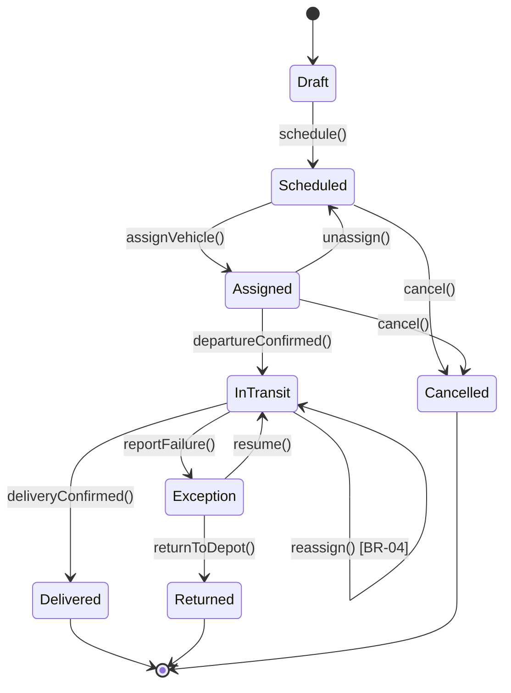
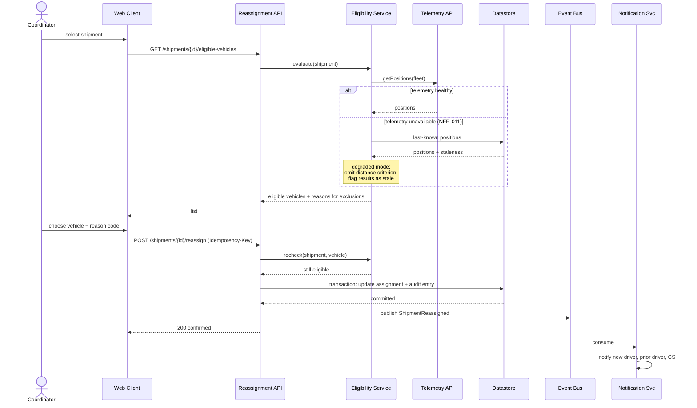
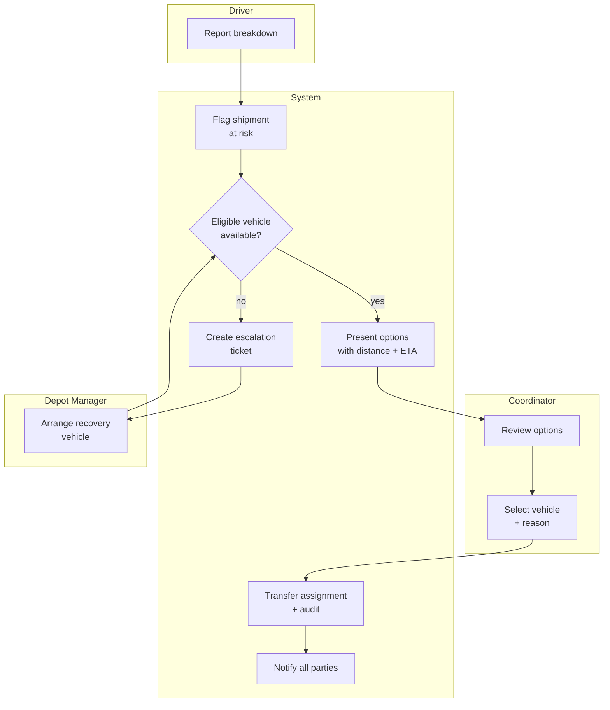

# Phase 6 — System Modeling

Goal: turn the requirements catalog into models that expose gaps, contradictions, and missing behavior before anyone writes code.

Prose requirements hide problems well. A state machine with an undefined transition is visibly broken; the same gap in a paragraph reads fine. Modeling is a defect-detection activity as much as a documentation activity — expect each model to send you back to Phase 4 with new requirements, and treat that as the model doing its job.

## Contents
- [1. Choosing models](#1-choosing-models)
- [2. State machines](#2-state-machines)
- [3. Sequence diagrams](#3-sequence-diagrams)
- [4. Activity and process models](#4-activity-and-process-models)
- [5. Logical data model](#5-logical-data-model)
- [6. Interface catalog](#6-interface-catalog)
- [7. Decision tables](#7-decision-tables)
- [8. Failure mode analysis](#8-failure-mode-analysis)
- [Exit criteria](#exit-criteria)

---

## 1. Choosing models

Build the models that answer questions you actually have. Building all of them mechanically produces a thick document and little insight.

| Question | Model |
|---|---|
| What states can this thing be in, and how does it move between them? | State machine |
| How do components collaborate for this scenario? | Sequence diagram |
| What's the end-to-end process, including human steps? | Activity / BPMN |
| What data exists and how is it related? | Logical data model / ERD |
| What crosses the system boundary? | Interface catalog |
| Which combination of conditions produces which outcome? | Decision table |
| What happens when this breaks? | Failure mode analysis |

**Rule of thumb:** model anything with more than three states, more than three interacting parties, more than three conditions, or any lifecycle where "what happens if it's already X?" has an unclear answer.

## 2. State machines

The single highest-yield model. Any entity with a `status` field has an implicit state machine; making it explicit reveals the transitions nobody specified.



For each transition specify: trigger, guard condition, actor/permission, side effects (events, notifications, audit), and whether it's reversible. For each state specify: what's permitted while in it, what's blocked, timeouts, and whether it's terminal.

**Then run the completeness matrix** — every state × every event. Most cells will be "not applicable," but each one you have to think about is a potential requirement.

| | schedule | assign | depart | deliver | cancel | reassign |
|---|---|---|---|---|---|---|
| Draft | → Scheduled | ✗ error | ✗ error | ✗ error | → Cancelled | ✗ error |
| Scheduled | ✗ no-op | → Assigned | ✗ error | ✗ error | → Cancelled | ✗ error |
| Assigned | ✗ error | → Assigned (replace) | → InTransit | ✗ error | → Cancelled | → Assigned |
| InTransit | ✗ error | ✗ error | ✗ no-op | → Delivered | **?** | → InTransit |
| Delivered | ✗ error | ✗ error | ✗ error | ✗ no-op | **?** | ✗ error |

The two `?` cells are real requirements gaps found by the matrix: can an in-transit shipment be cancelled (recall the vehicle?), and can a delivered shipment be cancelled (reversal? return? accounting implications?). Neither appeared in any interview. Both need answers.

Also decide, once, globally: does an invalid transition throw an error, or silently no-op? Inconsistency here produces confusing behavior and confusing tests.

## 3. Sequence diagrams

Draw one per architecturally significant scenario — not per requirement. Good candidates: the primary use case, the most complex integration, each failure scenario from the NFR quality attribute scenarios, and any flow crossing three or more components.



Three details worth carrying into every sequence diagram, because each corresponds to a defect class:

- **The recheck before commit.** Eligibility was evaluated when the list was built; state may have changed since. Time-of-check to time-of-use gaps cause real incidents.
- **The idempotency key.** Networks retry; users double-click. Without it, duplicate reassignments and duplicate events.
- **The transaction boundary.** Assignment and audit entry commit together, or neither does. Where the boundary sits is an architectural decision worth making explicitly.

Also model the **unhappy paths**: what happens if the event publish fails after the DB commit? (Transactional outbox, or accept the inconsistency — decide and record it.)

## 4. Activity and process models

Use when the end-to-end process spans human and system steps, has parallel paths, or crosses organizational boundaries. Swimlanes make handoffs and ownership visible, and handoffs are where processes break.



Annotate each step with elapsed time and each decision with its rule ID. That turns the diagram into evidence for whether the 3-minute end-to-end target (STK-07) is achievable — and frequently reveals that the bottleneck is a human step no amount of software will fix.

## 5. Logical data model

The domain model from Phase 4 was conceptual. The logical model adds attributes, types, keys, cardinality, and constraints — still independent of any particular database technology.

For each entity: attributes with type, nullability, default, and validation rule; primary key and natural key; foreign keys with cardinality and referential action on delete; unique constraints; and indexes implied by known access patterns.

**Model these explicitly — they're the ones that get missed:**

- **Temporal data.** Does history matter? A `Shipment.vehicle` field loses history; an `Assignment` entity with validity ranges preserves it. If anyone ever asks "who had it at 14:30?", you need the second. Bitemporal (valid time + transaction time) if you also need "what did we *believe* at 14:30?" — common in finance and compliance.
- **Soft delete and retention.** Deleted-but-retained rows affect every query and every unique constraint. Decide the policy once and apply it uniformly.
- **Audit.** What, retained how long, immutable or not.
- **Multi-tenancy.** Shared schema with tenant discriminator, schema-per-tenant, or database-per-tenant. This is one of the hardest decisions to reverse — decide it now, not in Phase 7.
- **Reference data.** Which lookup values are static, which are business-editable (per the volatility field on business rules), and which are versioned.
- **PII.** Tag every field carrying personal data. Drives encryption, masking, log redaction, export, and erasure — all much cheaper to build in than to retrofit.

Also record **access patterns**: the top queries with expected frequency and selectivity. They determine indexing, partitioning, and often the storage technology itself. A model without access patterns produces a schema optimized for nothing in particular.

## 6. Interface catalog

Every crossing of the system boundary, cataloged. This is where integration defects come from — usually from an assumption nobody wrote down.

```
IF-03  Transport Management System — Assignment Write

Direction:      Outbound (this system → TMS)
Protocol:       REST/JSON over HTTPS, mTLS
Purpose:        Persist assignment change to the system of record
Trigger:        Reassignment committed locally
Frequency:      ~40/week, bursts up to 15/min during incidents
Payload:        shipmentId, vehicleId, effectiveAt, reasonCode, actorId
Response:       200 with TMS revision; 409 on version conflict
Idempotency:    Idempotency-Key header; TMS deduplicates for 24 h
Auth:           mTLS + service account, credentials rotated quarterly
SLA (theirs):   p95 400 ms, 99.5% monthly availability
Failure modes:  Timeout → queue and retry (exp. backoff, 5 attempts, 10 min cap)
                409 conflict → refetch, re-evaluate, surface to coordinator
                5xx → queue, alert ops after 3 consecutive failures
                Sustained outage → PENDING_SYNC mode per NFR-011
Data ownership: TMS is system of record for shipment assignment;
                this system owns the reassignment reason and audit trail
Versioning:     v2; TMS gives 90 days notice; v1 sunsets 2026-12
Contact:        TMS platform team, #tms-support
Test env:       Available; synthetic fleet, resets nightly
Trace:          FR-014, NFR-011, RSK-04
```

Do this for every external system, every inbound webhook, every file drop, every scheduled export, and every message topic. The fields that get skipped and later hurt: **idempotency**, **data ownership**, **versioning policy**, and **whether a usable test environment exists**. That last one has schedule impact — discovering in week 8 that the partner has no sandbox is a common and avoidable disaster.

## 7. Decision tables

When an outcome depends on several conditions, a table is unambiguous where prose is not, and it makes completeness checkable.

**BR-04 — vehicle eligibility:**

| Status ACTIVE | Capacity ≥ volume | Within 15 km | Duty hours ≥ 2h | Cert covers class | → Result |
|---|---|---|---|---|---|
| N | – | – | – | – | Ineligible: vehicle inactive |
| Y | N | – | – | – | Ineligible: insufficient capacity |
| Y | Y | N | – | – | Ineligible: out of range |
| Y | Y | Y | N | – | Ineligible: insufficient duty hours |
| Y | Y | Y | Y | N | Ineligible: certification |
| Y | Y | Y | Y | Y | **Eligible** |

Check completeness (every combination covered, via wildcards), consistency (no combination yields two results), and redundancy (rules that can never fire). Note that this table also specifies *which* reason to show — a detail that matters, since "no vehicles available" without explanation is exactly what drives coordinators back to the phone.

Where the ordering of checks is itself a requirement (show the most actionable reason first), state it.

## 8. Failure mode analysis

For each component and dependency, work through: how it can fail, what the effect is, how it's detected, and what the response is. This is where a large share of the remaining requirements live.

| Component | Failure mode | Effect | Detection | Response | Requirement |
|---|---|---|---|---|---|
| Telemetry API | Unavailable | No live positions | Health check, 30 s | Last-known + staleness badge; drop distance criterion | NFR-011, FR-019 |
| Telemetry API | Stale data (returns old positions as current) | Wrong eligibility, silently | Timestamp validation | Reject positions older than 5 min; treat as unavailable | FR-020 |
| TMS | Unavailable | Can't write to system of record | Timeout | Queue as PENDING_SYNC, warn coordinator | NFR-011, FR-021 |
| TMS | Slow (within timeout) | Latency budget blown | p95 monitoring | Circuit breaker at 3 s | NFR-006 |
| Event bus | Publish fails post-commit | Notifications never sent | Outbox age monitor | Transactional outbox + retry | FR-022 |
| Notification | Device offline | Driver unaware | Delivery receipt timeout | Retry 10 min, then alert coordinator | FR-023 |
| Own DB | Primary failure | Total outage | Health check | Failover, RTO 5 min per NFR-008 | NFR-008 |

The **stale data** row is worth generalizing: a dependency returning wrong data is more dangerous than one returning nothing, because nothing is detected immediately and wrong is not. Every integration needs a freshness or sanity check, and it needs to be a requirement rather than an implementation detail someone might remember.

## Exit criteria

- [ ] State machine for every entity with a status field; state × event matrix completed
- [ ] Sequence diagrams for the primary flow, key integrations, and each failure scenario
- [ ] Process model where human and system steps interleave, with timings
- [ ] Logical data model with types, keys, constraints, PII tags, and access patterns
- [ ] Temporal, soft-delete, audit, and multi-tenancy decisions made explicitly
- [ ] Every boundary crossing in the interface catalog, with idempotency, ownership, and versioning
- [ ] Decision tables for multi-condition rules, checked for completeness and consistency
- [ ] Failure mode analysis covering every dependency, including wrong-data modes
- [ ] New requirements discovered during modeling folded back into Phases 4 and 5
