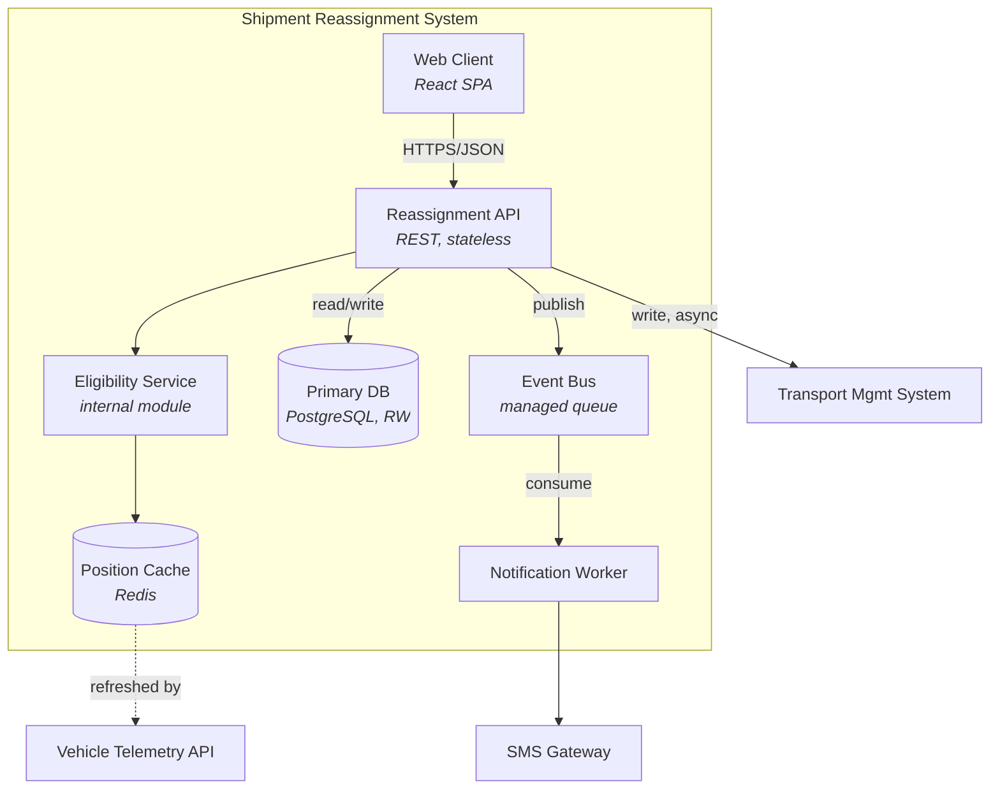

# Phase 7 — Architecture

Goal: turn the requirements, especially the NFRs, into a structure — components, their responsibilities, how they communicate, what technology they run on — with the reasoning recorded well enough that someone can defend or revisit each decision later.

Architecture is the set of decisions that are expensive to change. Everything else is just code. The job of this phase is to make those decisions deliberately, driven by requirements rather than by habit or by whatever was in the last tutorial read.

## Contents
- [1. Architecture follows quality attributes](#1-architecture-follows-quality-attributes)
- [2. C4 model](#2-c4-model)
- [3. Architectural styles](#3-architectural-styles)
- [4. Choosing a style](#4-choosing-a-style)
- [5. Cross-cutting concerns](#5-cross-cutting-concerns)
- [6. Technology selection](#6-technology-selection)
- [7. Architecture Decision Records](#7-architecture-decision-records)
- [8. Evaluating the architecture (ATAM-lite)](#8-evaluating-the-architecture-atam-lite)
- [9. Risk register](#9-risk-register)
- [10. The architecture document](#10-the-architecture-document)
- [Exit criteria](#exit-criteria)

---

## 1. Architecture follows quality attributes

Functional requirements mostly determine what code gets written; they rarely determine the shape of the system. The shape is determined by the top architectural drivers identified in Phase 5 — the NFRs that would change the structure if relaxed.

Before proposing any structure, restate those drivers explicitly:

```
ARCHITECTURAL DRIVERS

1. NFR-006  Reassignment confirm p95 ≤ 2.0s under 120 concurrent users
2. NFR-008  99.9% monthly availability, RTO 5 min, RPO 1 min
3. NFR-011  Full function when TMS or telemetry is degraded/unavailable
4. NFR-014  New cargo class addable in <4h touching ≤2 modules
5. CON-03   Team of 3, 10-week timeline, no prior distributed-systems experience
```

Every major structural decision from here on should trace back to one of these. If a decision doesn't trace to a driver, it's probably a preference, not a requirement — which is fine, but label it as such in the ADR.

Note driver #5. Team size, timeline, and skill are legitimate architectural drivers, not excuses. An architecture the team cannot build, operate, or debug is not a safe choice regardless of its theoretical merits.

## 2. C4 model

Four levels of zoom, each for a different audience. Not every project needs all four — Lite tier typically stops at Container; Rigorous tier does all four for the core subsystem.

**Level 1 — System Context.** Same content as the Phase 1 context diagram, refined. Audience: anyone, including non-technical stakeholders.

**Level 2 — Container.** The deployable/runnable units — web app, API, database, queue, batch job — and how they talk. This is the level most architecture conversations should happen at.



**Level 3 — Component.** Inside one container, its internal modules and their responsibilities. Draw this only for containers with real internal complexity — a thin CRUD API doesn't need it.

**Level 4 — Code.** Class or package structure. Usually better left to the code itself (generated diagrams, IDE navigation) than hand-maintained — hand-maintained code-level diagrams go stale within a sprint.

## 3. Architectural styles

No style is universally correct. Each is a bet on which quality attribute matters most, paid for with a cost somewhere else.

| Style | Optimizes for | Costs | Fits |
|---|---|---|---|
| **Layered / n-tier** | Simplicity, familiarity, fast onboarding | Can encourage tight coupling if layers leak | Most CRUD-centric apps, small teams |
| **Modular monolith** | Deployment simplicity + internal separation of concerns | Requires discipline to keep module boundaries real | Most projects that aren't yet proven to need distribution |
| **Microservices** | Independent deployability and scalability per component, team autonomy | Operational complexity, distributed-systems failure modes, network cost, data consistency | Multiple independent teams, genuinely divergent scaling needs, mature ops capability |
| **Event-driven** | Loose coupling, natural async workflows, extensibility | Harder to trace a request end-to-end, eventual consistency to reason about | Workflows with many independent reactions to one event |
| **Hexagonal / ports & adapters** | Testability, swappable infrastructure | More upfront structure/boilerplate | Business logic that must stay independent of frameworks and external systems |
| **CQRS** | Read/write workloads with very different shapes or scale | Two models to keep consistent, more moving parts | Read-heavy systems with expensive or differently-shaped writes |
| **Serverless / FaaS** | Scale-to-zero, no server management, pay-per-use | Cold starts, vendor lock-in, harder local dev and debugging | Spiky or low-frequency workloads, small teams without ops capacity |
| **Pipe-and-filter / batch** | Composable, testable transformation stages | Not suited to low-latency interactive needs | ETL, data processing |

**The honest default for most projects in this skill's typical usage — student projects, MVPs, small teams — is a modular monolith with clean internal boundaries.** It is the style most often skipped past in favor of something more impressive-sounding, and skipping past it is usually a mistake: it preserves nearly all future options (module boundaries can become service boundaries later, when a real scaling need proves it) while avoiding the tax of distributed systems paid from day one.

**Reach for microservices only when a specific driver demands it**: distinct scaling profiles that make co-deployment wasteful, genuinely independent teams needing independent release cadence, or a regulatory requirement for isolation. If none of the drivers demand it, note that explicitly in the ADR — "no driver requires independent deployability; modular monolith chosen" is a complete and defensible rationale.

## 4. Choosing a style

Score serious candidates against the top drivers rather than picking by familiarity or trend:

```
                          NFR-006   NFR-008   NFR-011   NFR-014   CON-03
                          latency   avail.    degrade   modify    team/time
Modular monolith            ++        +         +         ++        ++
Microservices                +        ++        +          +        --
Event-driven (core flow)     -        ++       ++          +         -
Modular monolith
  + async outbox for TMS    ++        +        ++         ++         +
```

The last row is frequently the answer: a single deployable unit for simplicity and modifiability, with an event-driven pattern (transactional outbox, async integration) applied specifically where NFR-011's degraded-mode requirement demands it — rather than making the whole system event-driven because one integration needs it. Mixing styles *within* a modular monolith, applied only where a driver demands it, usually beats committing the whole system to one style.

**Layering.** Within any style, keep a clear separation: presentation, application/use-case orchestration, domain (business rules — no framework dependencies), and infrastructure (persistence, external calls). This is what actually delivers NFR-014's modifiability target — a new cargo class touches the domain layer and maybe one adapter, not five layers.

## 5. Cross-cutting concerns

These apply across every component. Deciding them once, centrally, prevents the far more common failure of each component reinventing them slightly differently.

**Authentication & authorization** — where enforced (gateway vs each service), token format and lifetime, how service-to-service calls authenticate, how the authorization model (from Phase 5's security NFRs) is implemented and kept consistent.

**Error handling** — a consistent error shape across the whole system, retryable vs terminal error distinction, and how errors map to the alternate/error flows specified in Phase 4's use cases. An API where every endpoint invents its own error format is a tax paid by every future integrator.

**Configuration** — environment-specific values, feature flags, and secrets, and specifically which of these can change without a redeploy. Recall BR-04's volatility note from Phase 4 — high-volatility business rules belong in configuration or a rules table, not in code, or NFR-014's 4-hour target becomes unreachable.

**Logging, metrics, tracing** — format, correlation ID propagation across every boundary in the interface catalog, what's mandatory per request. This directly implements the observability NFRs from Phase 5.

**Idempotency** — every mutating endpoint that can plausibly be retried (which, per the sequence diagrams in Phase 6, is most of them) needs an idempotency strategy, decided once as a pattern rather than per-endpoint.

**Data consistency** — per data class (from Phase 6's logical data model), state whether it needs strong or eventual consistency, and how that's achieved. This is the direct implementation of the tradeoff resolutions recorded in Phase 5 §7.

**Caching** — what's cached, invalidation trigger, staleness tolerance (ties directly to the degraded-mode NFR scenarios).

**API versioning and backward compatibility** — how a breaking change gets shipped without breaking existing consumers, referencing the versioning policy already captured per-interface in Phase 6.

## 6. Technology selection

Evaluate candidates against the drivers, not against popularity or the last technology someone on the team used. A blunt comparison matrix beats an unstructured debate:

```
Datastore for shipment/assignment data
Drivers: NFR-006 (latency), NFR-008 (RTO 5min/RPO 1min), strong consistency
for assignment writes (Phase 5 §7), team has 2 years' Postgres experience,
zero distributed-DB experience.

              PostgreSQL      DynamoDB         MongoDB
Fits drivers  Strong ACID,    Strong at scale, Flexible schema,
              mature backup/  but eventual     but consistency
              PITR for RPO    consistency by   model needs care
              target          default          for this use case
Team fit      High            Low              Medium
Ops burden    Low (managed)   Low (managed)    Low (managed)
Cost @ scale  Predictable     Pay-per-request, Predictable
              (managed tier)  can spike
Decision      SELECTED        Rejected         Rejected
Rationale     Strong consistency requirement + team familiarity outweigh
              DynamoDB's scale ceiling, which this project's volume (Phase
              1: ~40/week) doesn't approach. Revisit if volume grows 100x.
```

**Evaluation dimensions, roughly in priority order:** fit to the architectural drivers; team's actual skill with it, not aspirational skill; ecosystem maturity and community size (a two-week-old library is a liability regardless of how elegant it looks); operational burden (self-hosted vs managed, and who's on call for it); licensing and cost at the *projected* scale, not today's scale; and how hard it would be to migrate away from later, since some choices are cheap to reverse (a logging library) and some are structural (a primary datastore).

**Common mistake worth naming directly:** choosing a technology because it's what a tutorial used, or because it looks good on a resume. Both are real considerations — a student project legitimately gets to weigh "will this help me get hired" — but they should be named as a factor explicitly, in the ADR, rather than laundered as a technical justification. "Chose X partly for learning value, acceptable because Y driver has slack" is honest and fine. Silently pretending a resume-driven choice was purely technical isn't.

## 7. Architecture Decision Records

Every decision with real consequences and real alternatives gets an ADR. This is the single highest-value artifact this phase produces — it is what lets someone six months from now (including a future instance of this same skill) understand *why*, not just *what*.

```
ADR-002  Modular monolith with async outbox for TMS integration

Status:      Accepted
Date:        2026-08-10
Deciders:    <names/roles>
Drivers:     NFR-006, NFR-008, NFR-011, NFR-014, CON-03

Context
  The system must integrate with an external TMS that has its own SLA
  (p95 400ms, 99.5% availability) and must remain functional when the TMS
  is degraded (NFR-011). The team is 3 people with a 10-week timeline and
  no prior distributed-systems experience (CON-03). Reassignment volume
  is ~40/week (Phase 1), with no growth driver justifying independent
  service scaling.

Options considered
  1. Full microservices, each bounded context as its own deployable
     + Independent scaling and deployment per service
     - Distributed transaction/consistency complexity the team hasn't
       operated before; 10-week timeline doesn't allow for the learning
       curve; no driver requires independent scaling at this volume
  2. Modular monolith, synchronous TMS calls in the request path
     + Simplest to build and reason about
     - A slow or down TMS directly blocks reassignment, violating
       NFR-011 and risking NFR-006's latency budget
  3. Modular monolith, async outbox pattern for the TMS write
     + Preserves NFR-006 (TMS write moves off the critical path,
       confirmed in the latency budget in Phase 5 §6)
     + Satisfies NFR-011 directly: local commit succeeds even if TMS
       is down, sync catches up later
     + Matches team skill and timeline
     - Local and TMS state can diverge for a bounded window; needs a
       PENDING_SYNC status (already modeled in Phase 6's state machine)
       and a reconciliation job

Decision
  Option 3. A single deployable service with clear internal module
  boundaries (reassignment, eligibility, notification), using a
  transactional outbox for the TMS write specifically.

Consequences
  + NFR-006 and NFR-011 both satisfied without distributed-systems
    operational burden
  + Module boundaries are drawn to allow extraction into a separate
    service later, if volume or team structure changes that calculus
  - Requires an outbox table, a relay process, and a reconciliation
    job — nontrivial pieces
  - Eventual consistency window between local and TMS state must be
    visible to the coordinator (already covered: PENDING_SYNC state,
    FR-021)

Revisit if
  Reassignment volume grows past ~500/week, or the team splits into
  separate service-owning groups.
```

**When to write one:** any choice that was genuinely contested (real alternatives existed), that would be expensive to reverse, or that a future contributor would reasonably ask "why did we do it this way?" about. Not every configuration value needs one — that's noise, not decision history.

**A short ADR beats no ADR.** A one-paragraph version — context, decision, consequences — captured in the moment is worth far more than an exhaustive one written from memory a month later, if it's written at all.

## 8. Evaluating the architecture (ATAM-lite)

Before treating the architecture as settled, stress-test it against the drivers rather than just against "does it look reasonable."

For each top driver, walk the quality attribute scenario from Phase 5 through the proposed architecture and ask: does this structure actually satisfy it, or does it merely not obviously violate it? For each significant decision, name at least one real risk, one sensitivity point (a parameter where a small change would flip the decision — e.g. "if the team had prior Kafka experience, option 1 changes"), and one tradeoff it makes against a lower-priority attribute.

Do this as a working exercise, not a formality — the goal is to find the decision that looks fine until someone runs the numbers, before that someone is a production incident.

## 9. Risk register

Architecturally relevant risks, separate from the assumptions register in Phase 1 (assumptions are unverified facts; risks are things that might go wrong regardless of whether they're currently true).

| ID | Risk | Likelihood | Impact | Mitigation | Owner |
|---|---|---|---|---|---|
| RSK-04 | TMS API changes without adequate notice | Medium | High — breaks core flow | Contract tests against TMS staging in CI; version pin with monitored deprecation | API team |
| RSK-07 | Team unfamiliar with outbox pattern, ships it wrong | Medium | Medium — data inconsistency | Spike + code review checklist before Sprint 3; pair on first implementation | Tech lead |
| RSK-09 | Reassignment volume triples post-launch (new region) | Low | Medium — latency budget pressure | Load test at 3x now; module boundaries pre-drawn for extraction | Architect |

Every risk with Medium+ likelihood and Medium+ impact needs a named mitigation and owner, not just a description. A risk register that only describes risks without assigning response is a worry list, not a management tool.

## 10. The architecture document

Assemble the phase's output into one document (or a small set, at Rigorous tier):

```
1. Drivers                — the architectural drivers, restated
2. Context (C4-1)         — system context diagram
3. Containers (C4-2)      — container diagram + responsibilities
4. Components (C4-3)      — for containers with real internal complexity
5. Style & rationale       — chosen style(s), summarized; full reasoning in ADRs
6. Cross-cutting concerns  — auth, errors, config, observability, idempotency,
                             consistency, caching, versioning
7. Technology stack        — selected technologies with one-line rationale each,
                             full comparison in the relevant ADR
8. Data architecture       — how the logical model (Phase 6) maps to physical
                             storage, partitioning/sharding if any
9. Deployment view          — environments, CI/CD shape, rollback approach
10. ADR log                — index of all ADRs, linked
11. Risk register
12. Deferred decisions      — things deliberately not decided yet, and the
                             trigger that will force the decision
```

## Exit criteria

- [ ] Architectural drivers restated explicitly from Phase 5's top NFRs
- [ ] C4 context and container diagrams produced (component level where warranted)
- [ ] Style chosen with a driver-scored comparison against at least one real alternative
- [ ] Cross-cutting concerns (auth, errors, config, observability, idempotency, consistency, caching, versioning) each decided once, centrally
- [ ] Technology choices evaluated on fit-to-drivers and team fit, not popularity
- [ ] ADR written for every contested, expensive-to-reverse, or non-obvious decision
- [ ] Each top driver walked through the architecture as a quality attribute scenario
- [ ] Risk register has likelihood, impact, mitigation, and owner for every real risk
- [ ] Deferred decisions listed with their triggers
- [ ] New constraints or requirements discovered here folded back into earlier phases
